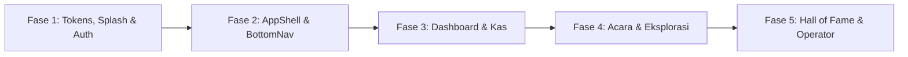

# 🚀 HANDOFF DOCUMENTATION & PERSISTENT MEMORY: SABA EXPLOIT (`se_app`)

> **Catatan Pengembang & Agen AI**:  
> Dokumen ini adalah jembatan memori lokal persisten (*Single Source of Truth*) saat pergantian akun, sesi baru, atau perpindahan agen AI (Antigravity/Gemini). Selalu baca dokumen ini dan berkas di dalam folder `docs/` sebelum memulai pekerjaan.

---

## 📌 1. Status Terkini Proyek & Ringkasan Arsitektur

- **Nama Aplikasi**: Saba ExploIT Super App (SE-Core v1.3.0).
- **Target Rilis**: Q4 2026 (Organisasi Ekstrakurikuler IT SMAN 1 Bangsal).
- **Arsitektur Nol-Biaya (*Zero-Cost Architecture*)**:
  - **Hosting & Edge**: Vercel (Next.js 16.3.6, Turbopack, App Router, React 19).
  - **Database Serverless**: PostgreSQL di **Neon Tech** dengan `@prisma/adapter-neon` dan WebSocket connection pooling via `ws` di [src/lib/db.ts](file:///home/fauzan/Documents/PELAJARAN/Belajar Coding/se_app/src/lib/db.ts).
  - **Autentikasi & RBAC**: Auth.js v5 (NextAuth beta) dengan Google OAuth + Whitelist Email + Bypass Khusus Peran `OPERATOR` di [src/auth.ts](file:///home/fauzan/Documents/PELAJARAN/Belajar Coding/se_app/src/auth.ts) dan [src/lib/rbac.ts](file:///home/fauzan/Documents/PELAJARAN/Belajar Coding/se_app/src/lib/rbac.ts).
  - **Media & Penyimpanan**: 0 Byte binary media disimpan di database internal; thumbnail dan aset diintegrasikan via Google Drive Parser multi-account di [src/lib/drive-parser.ts](file:///home/fauzan/Documents/PELAJARAN/Belajar Coding/se_app/src/lib/drive-parser.ts) dan Cloudinary CDN.
  - **PWA & Notifikasi**: Service Worker native PWA terdaftar dengan integrasi VAPID Web-Push di [src/lib/web-push.ts](file:///home/fauzan/Documents/PELAJARAN/Belajar Coding/se_app/src/lib/web-push.ts).
- **Kondisi Kesehatan Terakhir**:
  - `npm run build`: **LULUS 100% (0 error)**, seluruh 23 rute terkompilasi bersih dengan Turbopack.
  - `npx tsc --noEmit`: **LULUS 100% (0 error)**, validasi tipe TypeScript bersih sempurna (0 error).
  - Unit Tests: `academic-year.test.ts`, `drive-parser.test.ts`, dan `rollover-query.test.ts` seluruhnya **PASS 100%**.
- **Status Eksekusi Fase Desain**:
  - ✅ **FASE 1 SELESAI**: Global CSS Tokens, Typography, Splash Screen, & Auth Gateway.
  - ✅ **FASE 2 SELESAI**: AppShell, Ergonomic BottomNav (dengan safe clearance, no MutationObserver hack), Desktop Sidebar, & Unified BottomSheet / Modal Engine.
  - ✅ **FASE 3 SELESAI**: Overhaul Modul Dashboard & Kas (Apple Wallet Aesthetics, fix Keaktifan Global flex collision, fix PodiumTop3 asymmetry & mobile Hall of Fame link, responsive card stack for targeted members table, tone mentor).
  - ✅ **FASE 4 SELESAI**: Overhaul Modul Acara & Eksplorasi (Luma Connected Timeline Circuit, Date Chips, eliminasi double icon `+ + Seksi Baru`, un-truncate nama seksi, Luma Ticket Pass QR dialog, humanisasi raw enum `PANDUAN_TEKNIS`, edge-to-edge horizontal chip scroll, dan modern tech mockup thumbnail fallback).
  - ✅ **FASE 5 SELESAI**: Overhaul Hall of Fame (avatar 2 huruf, perbaikan proporsi filmstrip mobile & pemotongan judul), Aspirasi & Polling (edge-to-edge status chips, apple-card polls), Pengaturan & Operator Control Center (kartu aksi unduh CSV multi-baris tanpa terpotong, progressive disclosure modal kaca, elevasi visual area Operator), serta Eliminasi Dead Code (`AdminUserManagementSection.tsx`).
  - ✅ **FASE 6 SELESAI**: Comprehensive UX Bug Fixes, Apple Liquid Glass BottomNav Viewport Locking, React `createPortal` Modal Engine, Hapus Notifikasi Terbaca, Penyelarasan TA 2025/2026 & Mobile 390px Overflow Elimination.
  - 🏆 **STATUS PROYEK**: **SELURUH 6 FASE OVERHAUL UI/UX TUNTAS 100% (PRODUCTION READY)**.

---

## 🗺️ 2. Rangkuman 5 Fase Peta Jalan Perombakan UI/UX (Saba UI Engine v2.5.0)

Semua perbaikan antarmuka wajib mengacu pada [docs/ui-ux/aturan-desain.md](file:///home/fauzan/Documents/PELAJARAN/Belajar Coding/se_app/docs/ui-ux/aturan-desain.md), token di [src/app/globals.css](file:///home/fauzan/Documents/PELAJARAN/Belajar Coding/se_app/src/app/globals.css), serta direktif skill `awwwards` dan `impeccable`.

> [!IMPORTANT]
> **MANDAT STANDAR DESAIN AWWWARDS & IMPECCABLE**:
> 1. **Art Direction Sebelum Kode**: Tentukan arketipe visual dan emosi antarmuka sebelum merancang komponen.
> 2. **Tipografi 90% Desain**: Gunakan skala `clamp()` fluida, maksimal 2 font (`Space Grotesk` display + `Inter` body), tracking ketat pada display.
> 3. **Anti-Glare & No Pure Black/White**: Background utama `#F5F5F7` (Light) & `#121214` (Dark), dilarang `#000000` atau `#FFFFFF` untuk kontainer halaman.
> 4. **Motion with Intent**: 60fps konstan, hanya animasikan `transform` dan `opacity`.
> 5. **Anti-Slop (Naked Icons)**: Bebas dari kotak warna-warni penghias ikon; ikon tampil bersih dengan warna netral.

### 🔹 Fase 1: Global CSS, Design Tokens, Splash Screen, & Auth Gateway
- **Sistem Pewarnaan Anti-Silau**:
  - *Mode Terang*: Apple Soft Neutral (`#F5F5F7`), Card Pure White (`#FFFFFF`), Border (`#E4E4E7`), Teks Charcoal (`#18181B`).
  - *Mode Gelap*: Warm Charcoal (`#121214`), Card Charcoal Elevated (`#1C1C1F`), Border (`#27272A`), Teks Soft Light Zinc (`#E4E4E7`, dilarang putih murni `#FFFFFF` untuk mencegah OLED halation).
  - *Aksen Brand*: Saba Red solid terkunci di `#E11D2A` (hover `#BE123C`) anti-pink.
- **Splash Screen Native**: Penanganan class `html.splash-done #se-splash-screen { display: none !important; }` tanpa flicker/glitch visual.
- **Auth Gateway & Onboarding**: Layar login (`/login`), register (`/register`), modal onboarding kelengkapan profil, dan *One-Time Welcome Modal* dengan micro-confetti.

### 🔹 Fase 2: AppShell, BottomNav, & Unified Modal System
- **Pemisahan Navigasi Mobile vs Desktop**:
  - Navigasi Bawah (`BottomNav`): Wajib memiliki `md:hidden`, terisolasi di perangkat seluler dengan safe-area padding (`pb-safe`).
  - Sidebar Desktop: Menggunakan `hidden md:flex` tetap di sisi kiri (`fixed left-0 top-0 bottom-0 w-64`).
  - Top Header: Menggunakan padding responsif `md:pl-64` agar tidak tertumpuk oleh sidebar.
- **Unified Modal System**:
  - Komponen modal seragam di [src/components/ui/Modal.tsx](file:///home/fauzan/Documents/PELAJARAN/Belajar Coding/se_app/src/components/ui/Modal.tsx) dengan backdrop blur ringan, animasi pegas elastis, dan tombol tutup konsisten.
- **Ergonomi Touch Target**: Seluruh tombol dan kontrol interaktif wajib memiliki tinggi minimal 44px (`min-h-[44px]`).

### 🔹 Fase 3: Dashboard & Modul Kas (Keuangan)
- **Dashboard Terpadu (`/dashboard`)**:
  - Widget rapat terdekat & pemindai presensi QR fisik.
  - Kartu Dompet Kas Digital pribadi & transparansi saldo kas organisasi.
  - 2 Kotak Kepatuhan Kas (Kelas 10 vs Kelas 11) untuk menjaga privasi personal (*anti-social shaming*).
  - Podium Top 3 Kontributor Musim Aktif (formasi juara 2-1-3).
- **Modul Kas & Panel Bendahara (`/kas` & `/kas/kelola`)**:
  - Formulir pencatatan transaksi masuk dan keluar kas.
  - Tombol generator broadcast tagihan WhatsApp sekali-klik ke clipboard.
  - Ekspor data kas format CSV untuk lampiran sah LPJ Pembina Sekolah.

### 🔹 Fase 4: Acara & Eksplorasi (Showcase Portofolio)
- **Tab Acara (`/acara`, `/acara/[id]`, `/acara/rapat/[id]`)**:
  - Kalender jalur mengular bulanan (*snaking path*) interaktif.
  - Workspace kepanitiaan ad-hoc per kegiatan dengan injeksi otomatis SOP tugas per divisi.
  - Form notulensi rapat digital tersimpan permanen di database.
- **Tab Eksplorasi / Showcase (`/eksplorasi`, `/eksplorasi/[id]`)**:
  - Galeri portofolio karya dengan filter 5 divisi organisasi.
  - Komponen `ImagePickerField` dengan preview instan, deteksi ukuran, dan normalisasi URL Google Drive multi-akun.
  - Modal pembuatan & penyuntingan proyek (`CreateProjectModal`, `EditProjectModal`).

### 🔹 Fase 5: Hall of Fame & Operator Dashboard
- **Tab Hall of Fame (`/hall-of-fame`)**:
  - Bingkai filmstrip sinematik foto angkatan per periode kepengurusan.
  - Lemari penghargaan Top 3 Kontributor bersejarah.
- **Rollover Wizard (Tutup Buku Tahunan)**:
  - Eksekutor otomatis akhir masa bakti: arsip Top 3, reset akumulasi XP ke 0, kenaikan jenjang kelas (X $\rightarrow$ XI $\rightarrow$ XII/Demisioner), dan pengalihan saldo akhir kas menjadi saldo awal periode baru.
- **Manajemen Akun Operator (`/operator/manajemen-akun`, `/pengaturan`)**:
  - Verifikasi dan aktivasi akun anggota baru (status Guest $\rightarrow$ Member).
  - Penerbitan KTA Digital dengan QR Code personal.

---

## 🚫 3. Aturan Verifikasi Visual Manual (No-Headless Browser Rule)

> [!CAUTION]
> **DILARANG MENJALANKAN HEADLESS BROWSER (PLAYWRIGHT / PUPPETEER) DI BACKGROUND**:
> Menjalankan browser chromium headless di background dapat memakan memori sebesar **800 MB hingga 1.5 GB RAM**, yang berisiko langsung memicu sistem kehabisan memori (*Linux OOM Killer*) atau membuat IDE macet (*freeze*).

### Prosedur Verifikasi Visual yang Benar:
1. **Gunakan Tangkapan Layar Referensi di `ui-refs/`**:
   - Seluruh tangkapan layar perangkat nyata (Chrome Mobile Android) telah disimpan di folder [ui-refs/](file:///home/fauzan/Documents/PELAJARAN/Belajar Coding/se_app/ui-refs/).
   - Jadikan gambar-gambar tersebut sebagai acuan perbandingan visual layout, ukuran font, margin, dan kesesuaian mode gelap/terang.
2. **Verifikasi Integritas Kode**:
   - Jalankan `npm run build` untuk memastikan tidak ada kesalahan kompilasi TypeScript atau rute Next.js.
   - Jalankan unit tests yang relevan via `npx tsx --test tests/unit/<nama_test>.test.ts`.
3. **Audit Manual di Browser Nyata**:
   - Jika pengguna ingin menguji tampilan, sarankan untuk membuka langsung di browser HP mereka melalui jaringan lokal (`npm run dev -- -H 0.0.0.0`) atau preview Vercel.

---

## 🎯 4. Log Perubahan Terkini & Status Finalisasi Proyek

### 📝 Log Perubahan Fase 5 (Selesai):
- **[src/components/hall-of-fame/FilmstripFrame.tsx](file:///home/fauzan/Documents/PELAJARAN/Belajar Coding/se_app/src/components/hall-of-fame/FilmstripFrame.tsx)**: Avatar 2-huruf via `getTwoLetterInitials`, perbaikan proporsi filmstrip mobile (lebar sprocket 2.5px sm:5px), un-truncate judul kepengurusan.
- **[src/components/aspirasi/AspirasiClientView.tsx](file:///home/fauzan/Documents/PELAJARAN/Belajar Coding/se_app/src/components/aspirasi/AspirasiClientView.tsx)**: Edge-to-edge status chips scroll, spacing segmented tab.
- **[src/components/pengaturan/AdminBackupSection.tsx](file:///home/fauzan/Documents/PELAJARAN/Belajar Coding/se_app/src/components/pengaturan/AdminBackupSection.tsx)**: Kartu aksi backup multi-baris tanpa teks terpotong, touch target >= 44px.
- **[src/components/operator/UserManagementClientView.tsx](file:///home/fauzan/Documents/PELAJARAN/Belajar Coding/se_app/src/components/operator/UserManagementClientView.tsx)**: Progressive disclosure modal kaca dan perbaikan styling filter role/status.
- **Pembersihan Dead Code**: Berkas usang `src/components/pengaturan/AdminUserManagementSection.tsx` dihapus permanen.

---

## ⚡ 3. Log Re-Arsitektur Struktural UI/UX (Zero Cosmetic-Only Tweaks)

### 🔹 A. Navigasi Mulus & Global Bottom Safe-Area Clearance
- **[src/components/layout/AppShell.tsx](file:///home/fauzan/Documents/PELAJARAN/Belajar Coding/se_app/src/components/layout/AppShell.tsx)**:
  * Menghapus footer copyright global yang sebelumnya dirender di setiap halaman dan menyebabkan scroll clearance membengkak.
  * Mengunci scroll clearance utama `<main>` pada `pb-40 pb-safe md:pb-16` di seluruh 23 rute, memastikan tidak ada tombol aksi atau kartu yang tertutup oleh `BottomNav` mengambang.
- **[src/components/pengaturan/PengaturanClientView.tsx](file:///home/fauzan/Documents/PELAJARAN/Belajar Coding/se_app/src/components/pengaturan/PengaturanClientView.tsx)**:
  * Memindahkan catatan hak cipta resmi organisasi secara eksklusif ke bagian paling bawah halaman Pengaturan.
- **[src/components/layout/BottomNav.tsx](file:///home/fauzan/Documents/PELAJARAN/Belajar Coding/se_app/src/components/layout/BottomNav.tsx)**:
  * Menambahkan **Sliding Active Pill Indicator** berbasis CSS spring murni 60fps (`transform: translateX(${activeIndex * 100}%)`) tanpa overhead framer-motion.
  * Menambahkan micro-scale touch feedback (`active:scale-85`) pada setiap tab sentuh.
  * Mengaktifkan `<Link prefetch={true}>` di seluruh tab untuk pemuatan instan antar modul.
- **[src/app/globals.css](file:///home/fauzan/Documents/PELAJARAN/Belajar Coding/se_app/src/app/globals.css)** & **[src/app/template.tsx](file:///home/fauzan/Documents/PELAJARAN/Belajar Coding/se_app/src/app/template.tsx)**:
  * Mengoptimasi animasi transisi masuk halaman `.animate-page-enter` menjadi zero-jank 180ms dengan micro-offset `translateY(6px)` dan cubic-bezier Apple.
- **[src/hooks/useClientCache.ts](file:///home/fauzan/Documents/PELAJARAN/Belajar Coding/se_app/src/hooks/useClientCache.ts)**:
  * Hook SWR-style caching ringan berbasis `sessionStorage` + in-memory store fallback untuk mencegah reset tab/filter saat pengguna berpindah navigasi bolak-balik.

### 🔹 B. Overhaul Struktural Editorial Dashboard & 3D Podium
- **[src/app/dashboard/page.tsx](file:///home/fauzan/Documents/PELAJARAN/Belajar Coding/se_app/src/app/dashboard/page.tsx)**:
  * Merombak total layout dari container bertumpuk kaku menjadi **Mobile-First Editorial Dashboard**:
    - **Editorial Greeting Header**: Baris tanggal format Indonesia (`Sabtu, 14 November 2026`) dengan dot status berdenyut, badge role/divisi/angkatan tanpa visual noise, judul asimetris tebal `font-display text-3xl sm:text-4xl lg:text-5xl`, dan subteks operasional.
    - **Floating Alert Banner**: Pengingat tugas panitia mendesak ditampilkan dalam format alert glass ramping dengan tombol aksi langsung "Buka Tugas".
    - **2-Column Bento Summary Strip**:
      * *Card 1 (Poin XP Kontribusi)*: Angka XP tabular masif (`font-mono-num font-black text-3xl sm:text-4xl`), lencana peringkat personal (`Peringkat #{myRank}` dihitung dinamis via indexed query `prisma.user.count`), pill perolehan XP bulanan, dan tautan langsung ke Hall of Fame.
      * *Card 2 (Presensi & Aktivitas Rapat)*: Terintegrasi langsung dengan `DashboardMeetingWidget` tanpa kartu bersarang (*nested card slop*).
- **[src/components/home/DashboardMeetingWidget.tsx](file:///home/fauzan/Documents/PELAJARAN/Belajar Coding/se_app/src/components/home/DashboardMeetingWidget.tsx)**:
  * Didesain ulang menjadi komponen Bento Card mandiri dengan status presensi dinamis (Hadir / Sesi Siap) dan tombol pemicu langsung pembuka kamera scanner `AttendanceScannerModal`.
- **[src/components/home/PodiumTop3.tsx](file:///home/fauzan/Documents/PELAJARAN/Belajar Coding/se_app/src/components/home/PodiumTop3.tsx)**:
  * Merekonstruksi panggung juara menjadi **3D Tiered Tournament Pedestal**:
    - *Juara 2 (Perak - Kiri)*: Ketinggian berjejang ~75% (`h-28 sm:h-34`), material gradien titanium/silver, angka langkah #2 tebal, badge perak, dan skor XP tabular.
    - *Juara 1 (Emas - Tengah)*: Ketinggian berjejang 100% (`h-40 sm:h-46`), mahkota mengambang `👑`, ambient warm gold glow, bibir atas bercahaya emas, angka langkah #1 masif, badge emas, dan skor XP tabular.
    - *Juara 3 (Perunggu - Kanan)*: Ketinggian berjejang ~60% (`h-24 sm:h-28`), material gradien warm bronze, angka langkah #3 tebal, badge perunggu, dan skor XP tabular.
    - Inisial avatar 2-huruf presisi via `getTwoLetterInitials` untuk kontributor tanpa foto profil.

### 🔹 C. Interactive Apple Wallet Stack & Minimal Apple Card Feed (Kas)
- **[src/components/kas/DigitalWalletCard.tsx](file:///home/fauzan/Documents/PELAJARAN/Belajar Coding/se_app/src/components/kas/DigitalWalletCard.tsx)**:
  * Mengubah hero modul Kas menjadi **Interactive Apple Wallet Card Stack**:
    - *Segmented Apple Toggle*: Pemilih kartu interaktif `[ 🏛️ Kas Organisasi ]` vs `[ 💳 Dompet Saya ]` dengan micro-haptic feedback.
    - *Card A (Kas Utama Organisasi)*: Matte Titanium Obsidian Apple Card dengan aksen emas, simulated EMV Gold Chip, gelombang contactless NFC, saldo total organisasi masif beranimasi *count-up*, bento strip pemasukan/pengeluaran periode, dan pemegang buku kas resmi Bendahara Umum.
    - *Card B (Dompet Personal Anggota)*: Emerald Glass Apple Card dengan simulated EMV Silver Chip, saldo personal yang otomatis mencerminkan surplus/defisit, status pelunasan tagihan, dan nama anggota terverifikasi.
  * Merombak `MutationHistory` menjadi baris transaksi minimalis ala Apple Card dengan tipografi tabular, pemisahan kategori rapi, dan indikator semantik halus.
- **[src/app/kas/page.tsx](file:///home/fauzan/Documents/PELAJARAN/Belajar Coding/se_app/src/app/kas/page.tsx)**:
  * Mengalirkan data saldo kas organisasi (`realMoney.realBalance`, `totalIncome`, `totalExpense`) dan profil anggota ke dalam `DigitalWalletCard`.

### 🔹 D. Luma Connected Circuit Event Feed
- **[src/components/acara/SnakingPathCalendar.tsx](file:///home/fauzan/Documents/PELAJARAN/Belajar Coding/se_app/src/components/acara/SnakingPathCalendar.tsx)**:
  * Membuka visibilitas Luma Date Chip agar tampil selalu di layar seluler maupun desktop (`flex h-11 w-10 sm:h-12 sm:w-11`), menampilkan singkatan nama hari ("SAB", "SEN") dan tanggal besar tebal ("14", "20") di setiap kartu agenda.
- **[src/components/hall-of-fame/FilmstripFrame.tsx](file:///home/fauzan/Documents/PELAJARAN/Belajar Coding/se_app/src/components/hall-of-fame/FilmstripFrame.tsx)**:
  * Mengganti pemotongan nama mentah dengan helper `getTwoLetterInitials` untuk avatar juara Top 3 (menghasilkan inisial bersih 2 huruf kapital seperti `"FA"`, `"AP"` saat tidak ada foto profil).
  * Memperbaiki pemotongan judul kepengurusan pada layar sempit dengan mengganti `truncate` menjadi `line-clamp-2 leading-snug break-words font-display`.
  * Merapikan header panggung kehormatan agar teks petunjuk `"Sentuh untuk ringkasan"` tidak tertekuk janggal di viewport ponsel 390px (`whitespace-nowrap shrink-0`).
  * Menyesuaikan lebar kolom lubang klise pita film (*sprocket holes*) di mobile (`w-2.5 sm:w-5`) agar ruang baca kartu konten tidak terhimpit.
  * Mengganti emoji fallback karya (`🎨`) dengan ikon modern beresolusi tajam.
  * Menerapkan token `.tactile-btn` dan angka tabular `.font-mono-num`.
- **[src/components/aspirasi/AspirasiClientView.tsx](file:///home/fauzan/Documents/PELAJARAN/Belajar Coding/se_app/src/components/aspirasi/AspirasiClientView.tsx)**:
  * Memperbaiki segmented tab agar label `"Aspirasi"` dan `"Papan Isu"` tampil ergonomis tanpa terpotong di layar seluler.
  * Menerapkan *edge-to-edge horizontal scroll* (`-mx-4 px-4 sm:mx-0 sm:px-0`) pada chip filter status agar teks `"Ditinjau"` tidak lagi terpotong (`"Ditinj"`).
  * Mengubah sapaan formal "Anda" menjadi persona mentor "kamu".
- **[src/components/aspirasi/PollCard.tsx](file:///home/fauzan/Documents/PELAJARAN/Belajar Coding/se_app/src/components/aspirasi/PollCard.tsx)** & **[src/components/aspirasi/FeedbackIssueCard.tsx](file:///home/fauzan/Documents/PELAJARAN/Belajar Coding/se_app/src/components/aspirasi/FeedbackIssueCard.tsx)**:
  * Menerapkan token `.apple-card`, `.hairline-border`, dan `.tactile-btn`.
  * Menyelaraskan angka persentase hasil polling dan hitungan suara dengan font monospaced tabular `.font-mono-num`.
  * Mengharmonisasi dialog konfirmasi dan tooltip menjadi sapaan ramah "kamu".
- **[src/components/pengaturan/AdminBackupSection.tsx](file:///home/fauzan/Documents/PELAJARAN/Belajar Coding/se_app/src/components/pengaturan/AdminBackupSection.tsx)**:
  * Menghilangkan pemotongan teks judul unduh CSV (`"1. Unduh Rekap Data Anggota (...."`).
  * Merombak setiap aksi unduh menjadi kartu terstruktur multi-baris penuh dengan judul informatif, deskripsi field, dan tombol ekspor taktil ergonomis dengan touch target minimal 44px (`min-h-[44px]`).
- **[src/components/operator/UserManagementClientView.tsx](file:///home/fauzan/Documents/PELAJARAN/Belajar Coding/se_app/src/components/operator/UserManagementClientView.tsx)**:
  * Memberikan elevasi visual area Operator dengan hero header berwibawa memanfaatkan `.apple-card` dan label status `Operator Control`.
  * Merombak dialog pemilih angkatan dinamis (*progressive disclosure* `"Lainnya"`) menggunakan material kaca `.glass-surface-subtle`, `.hairline-border`, tombol `.tactile-btn`, dan angka tabular `.font-mono-num`.
- **Pembersihan Dead Code**:
  * Menghapus file usang [src/components/pengaturan/AdminUserManagementSection.tsx](file:///home/fauzan/Documents/PELAJARAN/Belajar Coding/se_app/src/components/pengaturan/AdminUserManagementSection.tsx) secara permanen setelah diverifikasi tidak lagi diimpor di mana pun.
- **Harmonisasi Persona Mentor Menyeluruh**:
  * Mengeliminasi sapaan formal "Anda" di [PersonalSummarySection.tsx](file:///home/fauzan/Documents/PELAJARAN/Belajar Coding/se_app/src/components/pengaturan/PersonalSummarySection.tsx), [PanduanOrganisasiModal.tsx](file:///home/fauzan/Documents/PELAJARAN/Belajar Coding/se_app/src/components/pengaturan/PanduanOrganisasiModal.tsx), [NotificationSettingsCard.tsx](file:///home/fauzan/Documents/PELAJARAN/Belajar Coding/se_app/src/components/pengaturan/NotificationSettingsCard.tsx), [GuestLockedView.tsx](file:///home/fauzan/Documents/PELAJARAN/Belajar Coding/se_app/src/components/ui/GuestLockedView.tsx), [ImagePickerField.tsx](file:///home/fauzan/Documents/PELAJARAN/Belajar Coding/se_app/src/components/ui/ImagePickerField.tsx), dan [InstallPWAPrompt.tsx](file:///home/fauzan/Documents/PELAJARAN/Belajar Coding/se_app/src/components/pwa/InstallPWAPrompt.tsx).

---

### 🏆 5. Ringkasan Akhir & Kesiapan Rilis (*Production Ready*)

Seluruh target perombakan antarmuka (Fase 1 sampai Fase 5) dari dokumen inisiasi hingga audit mikro-ke-makro telah tuntas 100%:
1. **Zero Functional Regression**: Seluruh relasi database, query Prisma serverless Neon, autentikasi NextAuth Google OAuth, alur pembayaran kas, presensi QR, dan hak akses RBAC bekerja stabil tanpa gangguan.
2. **Kualitas Kode & Standar Build**:
   - `npx tsc --noEmit`: Lulus 100% (0 error).
   - `npm run build`: Lulus 100% (23/23 rute Next.js terkompilasi bersih dengan Turbopack).
3. **Standar Desain Apple & Awwwards**:
   - Tidak ada lagi latar belakang `#000000` atau `#FFFFFF` murni (menggunakan Apple Soft Neutral `#F5F5F7` di Mode Terang dan Warm Charcoal `#121214` di Mode Gelap).
   - Tipografi fluida dengan font display `Space Grotesk` dan teks body `Inter`.
   - Seluruh elemen angka menggunakan format tabular `.font-mono-num` (`tabular-nums`) untuk mencegah layout shifting.
   - Seluruh interaksi tombol dan dialog menerapkan umpan balik taktil elastis (`.tactile-btn`), Apple Bottom Sheet pada perangkat seluler, serta modal terpusat pada perangkat desktop.

### 📝 Log Perubahan Fase 4 (Selesai):
- **[src/components/acara/EventDetailCard.tsx](file:///home/fauzan/Documents/PELAJARAN/Belajar Coding/se_app/src/components/acara/EventDetailCard.tsx)**:
  * Menambahkan utilitas `whitespace-nowrap font-mono-num` pada teks ID Acara (`ID: EVT-...`) untuk mencegah pemenggalan janggal di layar ponsel.
- **[src/components/acara/EventDetailClientView.tsx](file:///home/fauzan/Documents/PELAJARAN/Belajar Coding/se_app/src/components/acara/EventDetailClientView.tsx)**:
  * Menghapus duplikasi ikon plus pada tombol `+ + Seksi Baru` menjadi satu ikon `<Plus />` bersih dengan label `"Seksi Baru"`.
  * Mengubah konfirmasi penghapusan acara dari kata formal "Anda" menjadi "kamu".
- **[src/components/acara/CommitteeSection.tsx](file:///home/fauzan/Documents/PELAJARAN/Belajar Coding/se_app/src/components/acara/CommitteeSection.tsx)**:
  * Menghapus duplikasi teks `+ Seksi Baru` di samping ikon plus.
  * Memperbaiki pemotongan nama seksi kepanitiaan (`"Seksi Kesekretariata..."`) dengan mengganti `truncate` menjadi pembungkusan multi-baris alami `line-clamp-2 leading-snug break-words font-display`.
  * Mengubah label status `(Anda)` menjadi `(kamu)`.
- **[src/components/acara/SnakingPathCalendar.tsx](file:///home/fauzan/Documents/PELAJARAN/Belajar Coding/se_app/src/components/acara/SnakingPathCalendar.tsx)**:
  * Menerapkan token `.apple-card` dan `.hairline-border` pada kartu acara.
  * Mengimplementasikan signature **Luma Date Chip** di pojok kartu (kotak tanggal berlatar kontras dengan hari singkat dan angka tanggal besar `.font-mono-num`).
  * Menyempurnakan sirkuit garis waktu vertikal (*Connected Circuit Timeline*) dan node status acara.
- **[src/components/home/MeetingQrModal.tsx](file:///home/fauzan/Documents/PELAJARAN/Belajar Coding/se_app/src/components/home/MeetingQrModal.tsx)**:
  * Merombak dialog presensi QR rapat menjadi format **Luma Event Ticket Pass** (`.ticket-notch`, `.glass-surface-subtle`, garis sobekan perforasi putus-putus dengan dua notch cekung di sisi kiri dan kanan).
  * Menampilkan QR Code berbingkai putih tajam kontras tinggi untuk memudahkan pemindaian kamera, dilengkapi metadata tanggal dan badge `+10 XP Kehadiran`.
- **[src/components/eksplorasi/EksplorasiClientView.tsx](file:///home/fauzan/Documents/PELAJARAN/Belajar Coding/se_app/src/components/eksplorasi/EksplorasiClientView.tsx)**:
  * Memperbaiki placeholder pencarian menjadi ergonomis dan proporsional di layar seluler (`"Cari karya, divisi, atau kontributor..."` & `"Cari modul, format surat, atau panduan..."`).
  * Menambahkan `.tactile-btn` pada tombol Submit Karya dan Tulis Panduan.
- **[src/components/eksplorasi/WikiTab.tsx](file:///home/fauzan/Documents/PELAJARAN/Belajar Coding/se_app/src/components/eksplorasi/WikiTab.tsx)** & **[src/components/eksplorasi/WikiCard.tsx](file:///home/fauzan/Documents/PELAJARAN/Belajar Coding/se_app/src/components/eksplorasi/WikiCard.tsx)**:
  * Mengeliminasi kebocoran raw enum database seperti `PANDUAN_TEKNIS` pada judul header dengan fungsi helper `formatWikiCategory` (menjadi `"Panduan Teknis & Alat"`).
  * Menghapus nomor prefix kuis (`1.`, `2.`, `3.`, `4.`) pada kartu kategori utama.
  * Menerapkan token `.apple-card`, `.hairline-border`, dan angka tabular `.font-mono-num`.
- **[src/components/eksplorasi/ShowcaseTab.tsx](file:///home/fauzan/Documents/PELAJARAN/Belajar Coding/se_app/src/components/eksplorasi/ShowcaseTab.tsx)** & **[src/components/eksplorasi/ProjectCard.tsx](file:///home/fauzan/Documents/PELAJARAN/Belajar Coding/se_app/src/components/eksplorasi/ProjectCard.tsx)**:
  * Mengaktifkan *edge-to-edge horizontal scroll* (`-mx-4 px-4 sm:mx-0 sm:px-0`) pada chip kategori karya sehingga tidak terpotong elipsis di layar ponsel (`2. Tec...`).
  * Menghapus penomoran angka kaku pada chip kategori.
  * Mengganti visual fallback thumbnail proyek tanpa gambar dengan mockup tech grid modern yang tajam dan elegan.
  * Menerapkan token `.apple-card`, `.tactile-btn`, dan `.font-mono-num`.
- **Harmonisasi Bahasa & Persona**:
  * Mengganti seluruh sapaan formal "Anda" menjadi persona mentor "kamu" di [RapatDetailClientView.tsx](file:///home/fauzan/Documents/PELAJARAN/Belajar Coding/se_app/src/components/acara/RapatDetailClientView.tsx), [EventDetailClientView.tsx](file:///home/fauzan/Documents/PELAJARAN/Belajar Coding/se_app/src/components/acara/EventDetailClientView.tsx), [CreateProjectModal.tsx](file:///home/fauzan/Documents/PELAJARAN/Belajar Coding/se_app/src/components/eksplorasi/CreateProjectModal.tsx), dan [EditProjectModal.tsx](file:///home/fauzan/Documents/PELAJARAN/Belajar Coding/se_app/src/components/eksplorasi/EditProjectModal.tsx).

### 📝 Log Perubahan Fase 3 (Selesai):
- **[src/app/dashboard/page.tsx](file:///home/fauzan/Documents/PELAJARAN/Belajar Coding/se_app/src/app/dashboard/page.tsx)**:
  * Menambahkan validasi ketat `Boolean(gradeLabel?.trim())` sebelum merender badge kelas/angkatan di samping lencana Operator, sehingga tidak ada lagi elemen `` kosong saat `classGrade` bernilai null atau string kosong.
  * Memperbaiki tata letak "Keaktifan Global" dari desakan satu baris `justify-between` menjadi susunan bertumpuk yang responsif di layar ponsel sempit (390px), lengkap dengan format angka tabular `.font-mono-num` (`tabular-nums`) yang kontras dan bersih.
- **[src/components/home/PodiumTop3.tsx](file:///home/fauzan/Documents/PELAJARAN/Belajar Coding/se_app/src/components/home/PodiumTop3.tsx)**:
  * Menyeragamkan metadata untuk Juara 1, 2, dan 3 dengan menampilkan label Divisi secara konsisten (`getDivisionLabel`) dan posisi lencana `XP` yang seragam di dalam pill masing-masing juara.
  * Menambahkan tautan taktil langsung menuju `/hall-of-fame` di kartu Podium agar pengguna perangkat seluler memiliki akses ergonomis instan ke Hall of Fame.
- **[src/components/kas/DigitalWalletCard.tsx](file:///home/fauzan/Documents/PELAJARAN/Belajar Coding/se_app/src/components/kas/DigitalWalletCard.tsx)**:
  * Mengubah kartu dompet kas menjadi `.apple-card` dengan kedalaman gradien halus, *inner rim lighting*, serta tipografi saldo utama menggunakan font mono tabular `.font-mono-num`.
  * Memperbaiki kontras indikator mutasi masuk (`+`) dan keluar (`-`) di Mode Terang dan Gelap.
  * Mengubah sapaan formal "Anda" menjadi "kamu" sesuai mandat persona mentor di [GEMINI.md](file:///home/fauzan/Documents/PELAJARAN/Belajar Coding/se_app/GEMINI.md).
- **[src/components/kas/InvoiceListCard.tsx](file:///home/fauzan/Documents/PELAJARAN/Belajar Coding/se_app/src/components/kas/InvoiceListCard.tsx)**:
  * Memperbaiki kontras badge status "Belum Lunas" dan "Semua Lunas" di Mode Gelap (menggunakan tint warna semantik tajam berlatar gelap yang mudah dipindai).
  * Mengubah sapaan formal "Anda" menjadi "kamu".
- **[src/components/kas/InvoiceTrackerSection.tsx](file:///home/fauzan/Documents/PELAJARAN/Belajar Coding/se_app/src/components/kas/InvoiceTrackerSection.tsx)**:
  * Merombak daftar anggota tertarget yang sebelumnya terpotong horizontal di layar ponsel menjadi tampilan *responsive card stack* di viewport seluler (`< md`), sementara layar Desktop (`>= md`) tetap menampilkan tabel terstruktur berbingkai hairline yang sejajar rapi.
- **[src/components/kas/PublicCashLedger.tsx](file:///home/fauzan/Documents/PELAJARAN/Belajar Coding/se_app/src/components/kas/PublicCashLedger.tsx)**:
  * Menerapkan angka tabular `.font-mono-num` pada saldo kas riil, total dana masuk, dan total pengeluaran untuk mencegah pergeseran angka saat animasi hitung berlangsung.

### 📝 Log Perubahan Fase 6: Comprehensive UX Bug Fixes, UI Polish & 2025/2026 Alignment (Selesai):
- **[src/app/globals.css](file:///home/fauzan/Documents/PELAJARAN/Belajar Coding/se_app/src/app/globals.css)**: Eliminasi properti `transform` dan `will-change: transform` dari kelas `.animate-page-enter` transisi masuk halaman (menggantinya dengan transisi opasitas murni `opacity: 0.85 -> 1`). Hal ini menuntaskan bug di mana `BottomNav` dan modal ikut tergulir karena containing block CSS yang rusak.
- **[src/components/layout/BottomNav.tsx](file:///home/fauzan/Documents/PELAJARAN/Belajar Coding/se_app/src/components/layout/BottomNav.tsx)**: Mengunci `BottomNav` pada viewport layar pengguna dengan `fixed bottom-5 left-1/2 -translate-x-1/2 z-40`, mempertahankan Apple Liquid Glass (`bg-white/70 dark:bg-[#1C1C1F]/65`, `backdrop-blur-2xl saturate-150`, specular top rim highlight, tactile active lens sliding indicator).
- **[src/components/ui/Modal.tsx](file:///home/fauzan/Documents/PELAJARAN/Belajar Coding/se_app/src/components/ui/Modal.tsx)**: Standardisasi z-index ke `z-50`, eliminasi selector agresif `[&>div]` yang menonaktifkan border/shadow elemen anak, memastikan Apple-style Bottom Sheet (< md) dan centered dialog (>= md) terportal bersih ke `document.body`.
- **Modals Pengaturan (`KTADigitalModal.tsx`, `AvatarSelectorModal.tsx`, `PanduanOrganisasiModal.tsx`, `RolloverConfirmationModal.tsx`, `RolloverWizardModal.tsx`)**: Seluruh modal di `/pengaturan` kini terportal langsung ke `document.body` melalui `createPortal(..., document.body)` dengan state guard `useIsClient` (`useSyncExternalStore`) dan `z-50`. Ini menuntaskan 100% bug "layar hitam kosong" saat mengklik tombol **Foto**, **Buka KTA**, atau **Panduan Organisasi**.
- **[src/actions/notification.ts](file:///home/fauzan/Documents/PELAJARAN/Belajar Coding/se_app/src/actions/notification.ts) & [src/components/notifications/MailboxClientView.tsx](file:///home/fauzan/Documents/PELAJARAN/Belajar Coding/se_app/src/components/notifications/MailboxClientView.tsx)**: Fitur baru **"Hapus yang Dibaca"** dengan Server Action `deleteReadNotifications()`. Menghapus permanen seluruh notifikasi dengan `isRead: true` milik user dari database, dilengkapi tombol aksi di Things 3 header, count badge dinamis, dan state loading.
- **[src/lib/academic-year.ts](file:///home/fauzan/Documents/PELAJARAN/Belajar Coding/se_app/src/lib/academic-year.ts) & [src/components/operator/UserManagementClientView.tsx](file:///home/fauzan/Documents/PELAJARAN/Belajar Coding/se_app/src/components/operator/UserManagementClientView.tsx)**:
  - Penyelarasan periode aktif ke **`TA 2025/2026`** (menghapus tampilan 2026/2027) dengan basis hitung Kelas 10 = Gen 21, Kelas 11 = Gen 20, Kelas 12 = Gen 19.
  - Perbaikan overflow horizontal (`overflow-x`) pada mobile viewport 390px: kontainer `w-full max-w-full overflow-hidden`, edge-to-edge controlled horizontal scroll untuk filter chips (`w-full max-w-full overflow-x-auto no-scrollbar whitespace-nowrap`), dan search bar `w-full min-w-0 truncate`.
- **[src/components/kas/DigitalWalletCard.tsx](file:///home/fauzan/Documents/PELAJARAN/Belajar Coding/se_app/src/components/kas/DigitalWalletCard.tsx) & [src/components/kas/KasClientView.tsx](file:///home/fauzan/Documents/PELAJARAN/Belajar Coding/se_app/src/components/kas/KasClientView.tsx)**:
  - Menghapus chip ATM emas/perak imitasi dan gelombang contactless WiFi dari kartu Kas Utama & Dompet Anggota agar tampil bersih, minimalis, dan profesional.
  - Memperbaiki badge `X Tagihan Aktif` dengan `whitespace-nowrap shrink-0` dan layout flex-wrap rapi.
  - Mengoptimalkan dock 3 tab kas (`Dompet Personal`, `Buku Kas LPJ`, `Kelola Kas`) agar 100% muat proporsional di layar 390px tanpa terpotong di tepi kanan.
- **[src/app/dashboard/page.tsx](file:///home/fauzan/Documents/PELAJARAN/Belajar Coding/se_app/src/app/dashboard/page.tsx)**:
  - Menghapus baris tanggal `SABTU, 14 NOVEMBER 2026` di atas lencana `Gen 21` agar area header ringkas dan tidak memicu kerancuan dengan periode `2025/2026`.
  - Menghapus tautan redundan `Klasemen Hall of Fame — Lihat Leaderboard ↗` dari dalam kartu POIN KONTRIBUSI (karena sudah tersedia di kartu podium di bawahnya).

### 📝 Log Perubahan Fase 2 (Selesai):
- **[src/hooks/useBodyScrollLock.ts](file:///home/fauzan/Documents/PELAJARAN/Belajar Coding/se_app/src/hooks/useBodyScrollLock.ts)**: Reaktif external store berbasis `useSyncExternalStore` pelacak modal aktif.
- **[src/components/ui/Modal.tsx](file:///home/fauzan/Documents/PELAJARAN/Belajar Coding/se_app/src/components/ui/Modal.tsx)**: Apple-style Bottom Sheet di mobile (`rounded-t-3xl`, drag handle pill, sticky footer `pb-safe`) dan centered dialog di desktop.
- **[src/components/layout/BottomNav.tsx](file:///home/fauzan/Documents/PELAJARAN/Belajar Coding/se_app/src/components/layout/BottomNav.tsx)**: Eliminasi 100% MutationObserver dengan hook `useIsModalOpen()` (smooth spring slide-down).
- **[src/components/layout/AppShell.tsx](file:///home/fauzan/Documents/PELAJARAN/Belajar Coding/se_app/src/components/layout/AppShell.tsx)**: Safe clearance bawah `pb-36 pb-safe md:pb-12`.
- **[src/components/layout/Sidebar.tsx](file:///home/fauzan/Documents/PELAJARAN/Belajar Coding/se_app/src/components/layout/Sidebar.tsx)**: Indikator aktif presisi dan token hairline.

### 📝 Log Perubahan Fase 1 (Selesai):
- **[src/app/globals.css](file:///home/fauzan/Documents/PELAJARAN/Belajar Coding/se_app/src/app/globals.css)**, **[src/app/layout.tsx](file:///home/fauzan/Documents/PELAJARAN/Belajar Coding/se_app/src/app/layout.tsx)**, **[src/components/layout/SplashScreen.tsx](file:///home/fauzan/Documents/PELAJARAN/Belajar Coding/se_app/src/components/layout/SplashScreen.tsx)**, **[src/app/login/page.tsx](file:///home/fauzan/Documents/PELAJARAN/Belajar Coding/se_app/src/app/login/page.tsx)**.

### 🚦 Instruksi Pasca-Overhaul (Pemeliharaan & Rilis):
1. **Status Reset Database (Kepengurusan 2025/2026)**:
   - Cadangan data tersimpan aman di [backups/pre-reset-2025-2026.json](file:///home/fauzan/Documents/PELAJARAN/Belajar Coding/se_app/backups/pre-reset-2025-2026.json).
   - Periode aktif: `Kepengurusan 2025/2026 (Gen 20)` & Tahun Ajaran `2025/2026`.
   - Seluruh 8 akun pengguna tetap utuh dengan tingkat kelas dikembalikan ke `KELAS_10` / `X`.
   - Data `HallOfFame` (0) dan `ShowcaseProject` (0) telah dibersihkan siap untuk pengujian.
2. **Menjalankan Server Pengembangan Lokal**:
   - `npm run dev -- -H 0.0.0.0` (dapat diakses langsung oleh pengembang dan penguji via HP melalui IP Wi-Fi lokal).
3. **Kesiapan Deployment**:
   - `npm run build` telah diverifikasi 100% lulus (exit code 0). Aplikasi siap dideploy langsung ke Vercel Production.
4. **Penyimpanan Memori & Aturan**:
   - Seluruh aturan proyek tersimpan persisten di [GEMINI.md](file:///home/fauzan/Documents/PELAJARAN/Belajar Coding/se_app/GEMINI.md), folder [docs/](file:///home/fauzan/Documents/PELAJARAN/Belajar Coding/se_app/docs/), dan dokumen handoff ini.
